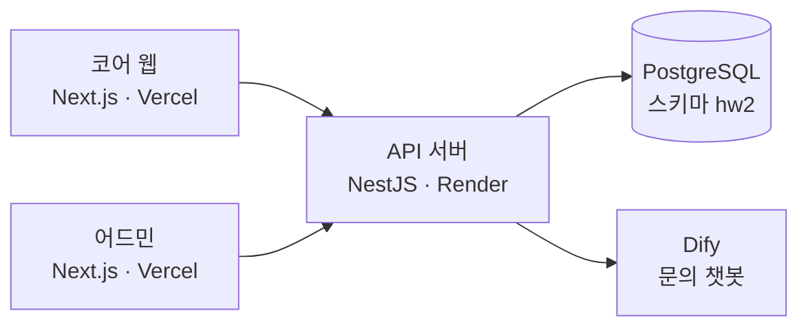
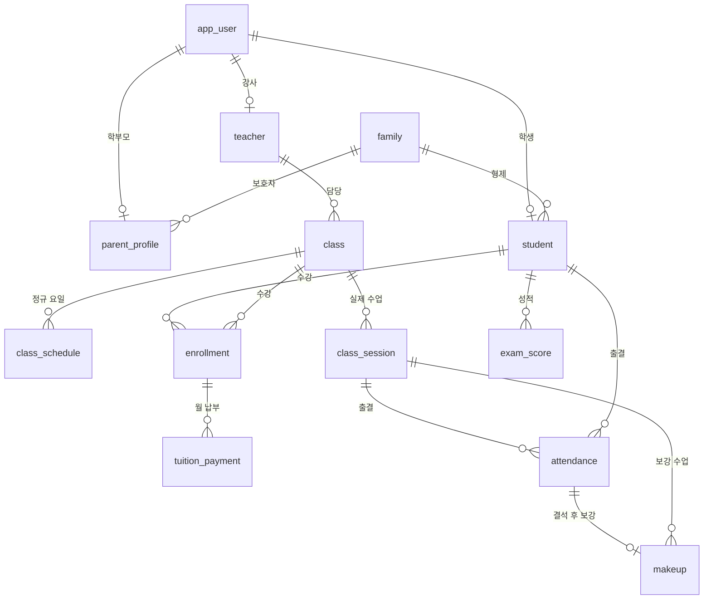

# 한빛수학 백엔드

수학학원 "한빛수학"의 코어 웹과 어드민이 함께 쓰는 API 서버예요. 수강·출결·보강·환불 규칙을 서버에서 검사하고, 거절할 때는 이유를 쉬운 말로 돌려줘요. AX Campus 3회차 과제로 만든 서비스이고, 학원과 사람, 숫자는 모두 가상이에요.

## 관련 링크

| 구분 | 서비스 | GitHub 저장소 |
|---|---|---|
| 코어 웹 | [웹사이트 열기](https://academy-enrollment-web.vercel.app) | [academy-enrollment-web](https://github.com/jexists/academy-enrollment-web) |
| 어드민 | [웹사이트 열기](https://academy-enrollment-admin.vercel.app) | [academy-enrollment-admin](https://github.com/jexists/academy-enrollment-admin) |
| 백엔드 API | [서버 상태 보기](https://academy-enrollment-backend.onrender.com/health) | [academy-enrollment-backend](https://github.com/jexists/academy-enrollment-backend) (현재 저장소) |

**발표 자료**: [HTML 슬라이드 27장 보기](https://jexists.github.io/academy-enrollment-web/)

> 무료 서버라서 15분 동안 요청이 없으면 잠들어요. 이때 첫 접속은 1분 가까이 걸릴 수 있어요.

## 기술 스택

**Backend**

<table>
  <tr>
    <td align="center" width="96"><br><sub>NestJS</sub></td>
    <td align="center" width="96"><br><sub>TypeScript</sub></td>
    <td align="center" width="96"><br><sub>TypeORM</sub></td>
    <td align="center" width="96"><br><sub>Vitest</sub></td>
  </tr>
</table>

**Database**

<table>
  <tr>
    <td align="center" width="96"><br><sub>PostgreSQL</sub></td>
  </tr>
</table>

**AI / External API**

<table>
  <tr>
    <td align="center" width="96"><br><sub>Dify</sub></td>
  </tr>
</table>

**Deployment**

<table>
  <tr>
    <td align="center" width="96"><picture><source media="(prefers-color-scheme: dark)" srcset="https://cdn.simpleicons.org/render/ffffff"></picture><br><sub>Render</sub></td>
  </tr>
</table>

## 주요 기능

- **인증·권한**: JWT와 bcrypt로 로그인을 처리하고, 원장·강사·학부모·학생 역할별로 API를 나눠요. 요청마다 계정을 다시 확인해서 사용 중지 계정과 임시 비밀번호 계정을 막아요.
- **수강 규칙**: 같은 반 중복, 정원, 학년 일치, 학생·강사 시간 겹침을 신청과 승인 때 모두 검사해요.
- **출결·보강**: 지각 3번을 결석 1번으로 계산하고, 결석 횟수와 그날 정원을 확인해 보강 자격을 판단해요.
- **환불·할인**: 그 달 실제 수업 수를 기준으로 환불액을 계산하고, 둘째 자녀부터 형제 할인 10%를 적용해요.
- **변경 기록**: 저장할 때마다 작성자와 전후 값을 `audit_log`에 남겨요. 삭제는 soft delete라서 되살릴 수 있어요.
- **문의 챗봇**: Dify 답변을 SSE로 전달하고, 질문과 근거 문서를 `chat_log`에 남겨요. 한 IP당 1분에 10번으로 제한해요.


## 시스템 구조



| API 묶음 | 경로 | 사용 역할 |
|---|---|---|
| 공개 | `/health`, `/public/*`, `/chat/messages` | 누구나 |
| 로그인 | `/auth/*` | 누구나, 로그인 사용자 |
| 관리 | `/admin/*` | 원장 |
| 직원 | `/staff/*` | 원장, 강사(담당 반) |
| 학부모 | `/parent/*` | 학부모 |
| 학생 | `/student/*` | 학생 |

## DB 구조

테이블은 20개이고, 모든 테이블에 작성·수정 정보와 `deleted_at` 칼럼이 있어요. 아래는 수강과 출결을 중심으로 추린 관계예요. 전체 정의는 [init.sql](src/database/init.sql)에 있어요.



정원·중복 같은 규칙은 서버에서 검사하고, 이메일과 진행 중 수강의 중복은 DB의 부분 UNIQUE 제약으로도 한 번 더 막아요.

## 프로젝트 구조

```text
src/
├── common/       # 인증 가드, 예외 필터, 시간 처리
├── config/       # 환경 변수 검증
├── database/     # init.sql (테이블과 제약의 원본)
├── modules/      # 업무별 모듈 (enrollments, attendance, payments, chat 등)
│   └── */*-rules.ts   # 업무 규칙 순수 함수와 테스트
└── main.ts
```

## 문서

- [테이블과 제약 전체](src/database/init.sql)
- [수강 신청 규칙](src/modules/enrollments/enrollment-rules.ts)
- [출결·보강 규칙](src/modules/attendance/attendance-rules.ts)
- [환불·할인 규칙](src/modules/payments/payment-rules.ts)
