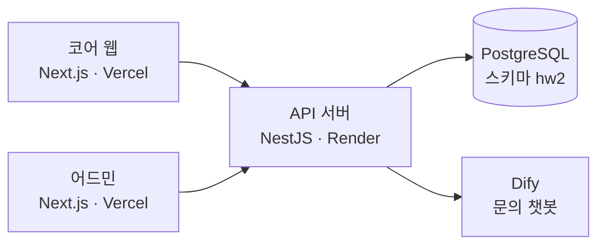
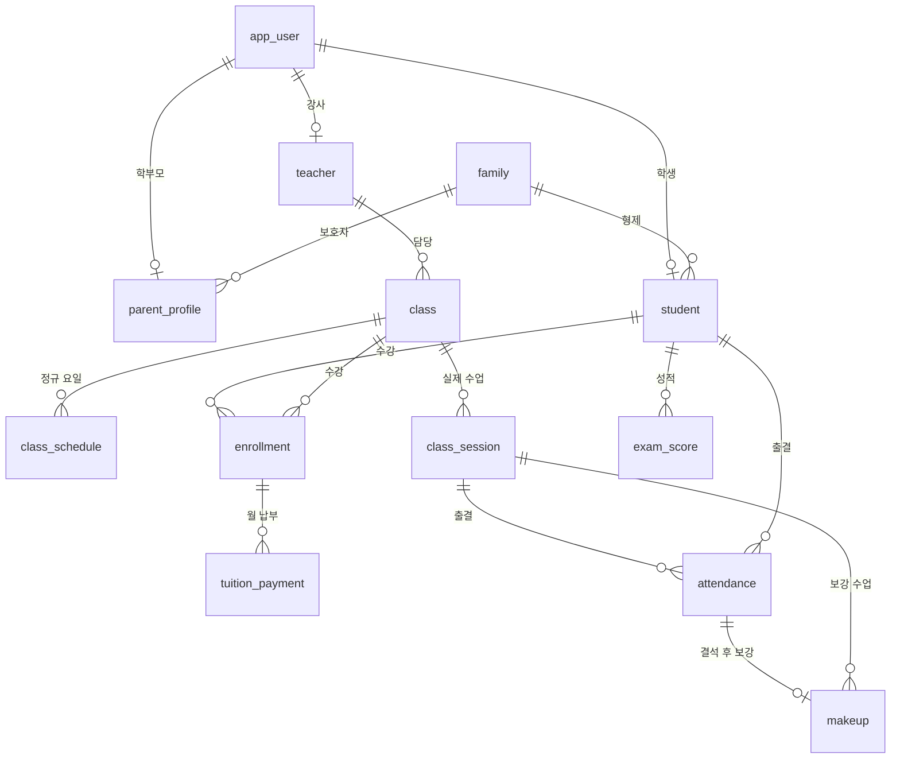

<div align="center">

# 한빛수학 백엔드

**코어 웹과 어드민이 함께 쓰는 API 서버**

수강·출결·보강·환불 규칙 검사, 거절 사유 안내 제공

<a href="https://academy-enrollment-web.vercel.app"></a> <a href="https://academy-enrollment-admin.vercel.app"></a> <a href="https://academy-enrollment-backend.onrender.com/health"></a> <a href="https://jexists.github.io/academy-enrollment-web/"></a>

<sub>코어 웹 <a href="https://github.com/jexists/academy-enrollment-web">저장소</a> &nbsp;·&nbsp; 어드민 <a href="https://github.com/jexists/academy-enrollment-admin">저장소</a> &nbsp;·&nbsp; <b>백엔드</b> <a href="https://github.com/jexists/academy-enrollment-backend">저장소</a></sub>

</div>

> AX Campus 3회차 과제 결과물. 학원·인물·수치는 모두 가상.
>
> 무료 서버 특성상 15분 미사용 시 절전 상태로 전환, 첫 접속에 최대 1분 소요.

## 기술 스택

| 구분 | 기술 |
|---|---|
| Backend |     |
| Database |  |
| AI / External API |  |
| Deployment |  |

## 주요 기능

| 기능 | 내용 |
|---|---|
| **인증·권한** | JWT·bcrypt 로그인, 역할별 API 분리, 요청마다 계정 재확인(사용 중지·임시 비밀번호 차단) |
| **수강 규칙** | 같은 반 중복, 정원, 학년 일치, 학생·강사 시간 겹침 검사 |
| **출결·보강** | 지각 3회 = 결석 1회 환산, 결석 횟수·정원 기준 보강 자격 판단 |
| **환불·할인** | 실제 수업 수 기준 환불액 계산, 둘째부터 형제 할인 10% |
| **변경 기록** | `audit_log` 전후 값 기록, soft delete 복원 |
| **문의 챗봇** | Dify 답변 SSE 전달, `chat_log` 질문·근거 기록, IP당 분당 10회 제한 |

## 화면 캡처

[규칙 거절 응답](https://github.com/jexists/academy-enrollment-web/blob/main/docs/captures/40-api-rejections.png) &nbsp;·&nbsp; [DB 제약: 수강 중복 거절](https://github.com/jexists/academy-enrollment-web/blob/main/docs/captures/43-dbeaver-B6-enrollment.png) &nbsp;·&nbsp; [DB 제약: 출결 중복 거절](https://github.com/jexists/academy-enrollment-web/blob/main/docs/captures/44-dbeaver-B10-attendance.png)

전체 캡처 폴더: [academy-enrollment-web/docs/captures](https://github.com/jexists/academy-enrollment-web/tree/main/docs/captures)

## 시스템 구조



| API 묶음 | 경로 | 사용 역할 |
|---|---|---|
| 공개 | `/health`, `/public/*`, `/chat/messages` | 누구나 |
| 로그인 | `/auth/*` | 누구나, 로그인 사용자 |
| 관리 | `/admin/*` | 원장 |
| 직원 | `/staff/*` | 원장, 강사(담당 반) |
| 학부모 | `/parent/*` | 학부모 |
| 학생 | `/student/*` | 학생 |

## DB 구조

전체 20개 테이블, 공통 칼럼으로 작성·수정 정보와 `deleted_at` 보유. 아래는 수강·출결 중심의 핵심 관계. 전체 정의는 [init.sql](src/database/init.sql) 참고.



정원·학년 등은 서버에서 검사, 이메일·진행 중 수강 중복은 DB 부분 UNIQUE 제약으로 이중 차단.

## 프로젝트 구조

<details>
<summary>폴더 구조 보기</summary>

```text
src/
├── common/       # 인증 가드, 예외 필터, 시간 처리
├── config/       # 환경 변수 검증
├── database/     # init.sql (테이블·제약 원본)
├── modules/      # 업무별 모듈 (enrollments, attendance, payments, chat 등)
│   └── */*-rules.ts   # 업무 규칙 순수 함수·테스트
└── main.ts
```

</details>

## 문서

[테이블·제약 전체](src/database/init.sql) &nbsp;·&nbsp; [수강 신청 규칙](src/modules/enrollments/enrollment-rules.ts) &nbsp;·&nbsp; [출결·보강 규칙](src/modules/attendance/attendance-rules.ts) &nbsp;·&nbsp; [환불·할인 규칙](src/modules/payments/payment-rules.ts)
